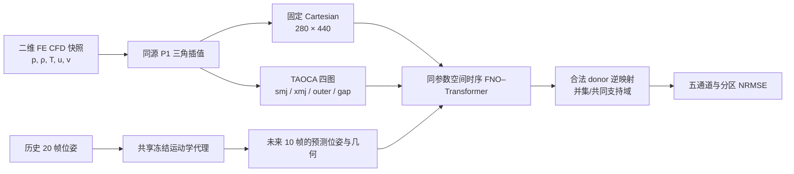

# 面向二维双体超声速分离流的 Cartesian 与重叠曲线图册表示：FNO–Transformer 时序预测的受控比较

> **稿件状态：内部论文式研究草稿，尚非投稿定稿。** 本文只归纳仓库中可复核的代码、协议和结果文件。作者、求解器版本、网格无关性、统计区间、跨几何验证等尚缺信息均不推测补写。TAOCA 未实现五通道全面优于 Cartesian；所有负面结果和限制均保留。

## 摘要

移动多体超声速流包含复杂物面、近壁梯度和移动激波。将非结构有限元（FE）流场输入规则张量模型时，笛卡尔采样便于使用 Fourier Neural Operator（FNO），但物面会被栅格化，局部采样预算也不能随物体边界自适应；局部贴体曲线网格可提高近壁几何表达，却增加图册之间的映射、融合与回映射误差。本文整理并评估一套面向二维 TSTO 双体分离数据的时序预测流程，比较固定 Cartesian 表示和 TAOCA（Topology-Aware Overlapping Curvilinear Atlas）四图表示。数据包含 Ma 5.0、5.5、6.0、6.5、7.0 五条轨迹共 500 帧，变量为压力、密度、温度和两个平面速度分量。模型以过去 20 帧预测随后 10 帧；未来物体位姿由仅依赖历史位姿的共享运动学代理给出，Cartesian 与 TAOCA 共用该代理。主要公平比较采用单随机种子、相同模型参数量（340,349）、每帧 123,200 个采样点和相同训练主配置；TAOCA V3 将四图径向采样预算设为 35/35/140/70。540 个重叠预测实例的共同合法支持域占报告目标域的 99.845%。相较 Cartesian，TAOCA V3 的全域温度、X 速度、Y 速度 NRMSE 分别降低约 8.0%、29.7%、6.0%，而压力、密度分别增加约 5.8%、7.2%；近壁五通道误差均降低约 24.1%–52.2%；高压力梯度代理区域的温度、两个速度误差降低，但压力、密度误差分别增加约 8.1%、28.9%。后续 TAOCA V7 在额外 60 轮微调及改变损失目标后，五通道平均误差进一步降低，但压力、密度全域误差仍高于 Cartesian，激波代理区域压力、密度也仍较差。结果说明该四图表示在本数据和模型中对近壁预测有潜在价值，但尚无证据支持其全面提升全域或激波预测，更没有证明其计算效率优势。单种子、单几何族、重复使用的时间切分测试集、非守恒插值以及缺乏求解器级 GCL 验证限制了结论的外推范围。

**关键词：** 可压缩流；超声速多体分离；Fourier Neural Operator；Transformer；Cartesian 网格；重叠曲线图册；流场预测

## 1. 引言

多体分离过程的非定常流场同时受刚体相对运动、物体尾迹、局部压缩和激波相互作用影响。对该类流动进行高分辨率 CFD 计算可得到丰富的物理细节，但若需要在参数研究、控制或不确定性分析中反复预测，快速替代模型具有实际意义。神经算子通过学习函数到函数的映射，为参数化 PDE 解算子近似提供了一类方法；FNO 在频域参数化积分核，并可在规则离散网格上高效计算。[1] Transformer 的自注意力机制则可用于建模时间序列中的长程依赖。[2]

FNO 等频域网络通常需要规则张量输入。最直接的做法是将 CFD 非结构节点场插值到固定 Cartesian 网格。该表示统一、实现简单、图像张量易于批量训练；但低分辨率栅格难以贴合曲面壁面，边界会出现台阶状表示，且固定采样预算可能过多投向远场背景、较少投向近壁层或间隙区域。另一方面，传统 overset/Chimera 思想通过多个相互重叠的网格组合描述复杂几何与相对运动。[3] 将局部曲线图册与神经算子结合，可能更有效地表达物面附近几何，但跨图插值、重复覆盖以及不同逻辑坐标下的激波位置漂移也可能降低预测精度。

本工作把 TAOCA 定义为一种项目级的数据表示方案：围绕双体局部区域构造两张 O 型贴体图、外部环形图和体间 gap 图，分别将 CFD 场映射到规则张量，再通过显式 donor/receptor 插值关系回到物理网格。本文不把成熟的多块网格、重叠网格、重心插值或分区融合单独宣称为原创理论。研究重点是检查这套表示在本任务中的收益及失效位置，并与 Cartesian 基线在共同数据、共同模型预算与共同物理支持域上作比较。

**图 1｜实验流程。** 两条流场路线共享时序数据、历史位姿代理和网络参数预算；TAOCA 的图册映射与 Cartesian 的固定网格映射是主要表示差异。训练数据和输出图片未随代码仓库发布。

本文回答三个问题：

1. 在相同总采样点预算与相同预测骨干下，四图 TAOCA 是否降低五个流场通道的全域误差？
2. 近壁收益是否伴随激波代理区域压力、密度误差的变化？
3. 重新分配 TAOCA 的径向采样预算、加入物理与回映射一致性目标后，现有改进能否支持“全面优于 Cartesian”的结论？

目前证据对第一个问题给出通道依赖的答案，对第二个问题显示近壁与激波区域存在明显差异；对第三个问题的答案是否定的：所有已核验版本都没有证明 TAOCA 五通道及高梯度压力、密度均全面优于 Cartesian。

## 2. 方法背景与研究定位

FNO 的典型谱层可写为

\[
v_{\ell+1}(x)=\sigma\!\left(W_\ell v_\ell(x)+\mathcal F^{-1}\!\left(R_\ell(k)\,\mathcal F[v_\ell](k)\right)(x)\right),
\]

其中 \(W_\ell\) 是逐点线性映射，\(R_\ell\) 是学习到的频域核，\(\mathcal F\) 与 \(\mathcal F^{-1}\) 分别为离散傅里叶变换及其逆变换。有限模态截断使其计算集中于低频全局结构；对激波等间断，频谱截断和有限分辨率仍可能造成位置误差及振荡，不能由使用 FNO 自动消除。

Overset 网格允许局部网格在复杂几何上独立构造，并通过 donor/receptor 关系在重叠区传递变量。[3] 本文 TAOCA 使用了相似的几何组织动机，但其目标是构造神经网络可读取的规则张量并回映射到原始 FE 节点，不是 Fluent 原生 overset connectivity 的复现，也不包含严格守恒的单元交叠面积重映射。因此，本文中“图册”描述的是局部参数化和接口集合，不代表已证明覆盖全流体域的严格数学 atlas 定理。

## 3. 数据与实验协议

### 3.1 数据集

数据来自二维 TSTO 双体分离计算的 Tecplot 有限元快照。按工况统计为 Ma 5.0（101 帧）、Ma 5.5（101 帧）、Ma 6.0（101 帧）、Ma 6.5（96 帧）和 Ma 7.0（101 帧），共 500 帧。每个快照使用五个节点变量，排列为压力 \(p\)、密度 \(\rho\)、温度 \(T\)、X 方向速度 \(u\)、Y 方向速度 \(v\)。壁面按命名边界 smj 与 xmj 识别；二维四节点单元被拆为三角形，退化三角形被过滤，供 P1 线性插值使用。

源 CFD 求解器版本、完整数值格式、网格收敛研究、湍流/转捩设定、边界条件以及原始数据公开地址未在当前代码和运行记录中形成可审计的完整元数据。本文不对这些信息作推断。数据文件本身因用户指定的仓库范围不上传，复现实验需由使用者另行提供原始快照。

### 3.2 时间切分与预测任务

按时间先后切分各工况轨迹，不随机打乱未来目标。正式联合/空间模型的数据 manifest 记录为 70% 训练、10% 验证、剩余时间测试，目标窗口必须完整落在所属时间段。冻结运动学代理的模型读取过去 20 帧，向前预测 10 帧；最终 54 个测试窗口提供 540 个“窗口–预测时刻”实例。由于连续窗口彼此重叠，这些实例不能视为独立统计样本。

两个流场路线共用从历史刚体位姿外推的冻结运动学代理。该代理对最近 20 帧位姿做局部时间多项式拟合，并与末两帧恒速外推组合；不读取未来 CFD 真值、不通过质量、惯量和气动力积分六自由度运动方程，也不是由本次 TAOCA/Cartesian 流场预测网络共同训练得到的轨迹网络。其作用是给两路线提供一致的未来几何近似，降低轨迹差异对网格表示比较的混杂。

### 3.3 两种空间表示

**Cartesian 基线。** 将每帧的原始三角形 FE 场按 P1 重心插值至固定世界坐标矩形网格。主实验分辨率为 \(280\times440\)，每帧共 123,200 个采样点。固体和域外点通过有效掩膜标记。

**TAOCA。** 构造四张图：smj 与 xmj 两张局部 O 图，outer 背景环形图，gap 桥接 H 图。物体边界采用周期相位重采样，局部 O 图按壁面曲线和法向偏移生成，并以离散 Jacobian 与有向单元面积筛除/修正翻折；V2 几何修复还对局部偏移作比例调整以保持正向单元。背景图固定于计算矩形 \([-10,100]\times[-20,50]\)，参考中心为 \((45,15)\)，内侧半径约为 1.5，外边界随矩形方向变化。径向拉伸为

\[
s(\eta)=0.05\eta+0.95\frac{1-\cos(\pi\eta)}{2},\quad
r(\eta,\theta)=1.5+s(\eta)(r_{\rm out}(\theta)-1.5),
\]

\[
\Phi_{\rm outer}(\eta,\theta)=(45,15)+r(\eta,\theta)(\cos\theta,\sin\theta).
\]

该背景环形图是固定背景层，物体内部及其无效采样点通过 mask 排除；不能把它说成整个时刻都无固体的单一外环。gap 图在两体相向壁面之间以及组合包络缺口位置构造 H 型桥接，内部同样依赖固体掩膜。V2 的四图等高分配为 \(70/70/70/70\)，周向 440 点；V3 在总预算不变时改为 \(35/35/140/70\)，周向仍为 440 点。因此每帧仍为 123,200 个张量位置。重复覆盖意味着相同张量点数并不等同于相同物理面积分辨率。

局部 O 图随相应物体的预测刚体位姿移动，outer 背景图固定，gap 根据两体几何建立桥接表示。未来 chart 坐标和固体掩膜由历史位姿代理构造，而不是从测试未来帧读取。outer 图含被 mask 的固体/内孔采样区，gap 承担部分中间覆盖；非法或穿过固体的 donor 被剔除，故不能把该实现描述为整个测试期严格包围流场或处处全局可逆。

### 3.4 正向插值与回映射

设原始三角剖分为 \(\mathcal T\)，其中某 donor 三角形顶点为 \(x_1,x_2,x_3\)。目标 chart 点 \(x\) 位于该三角形内时，其 P1 插值为

\[
q_h(x)=\lambda_1(x)q_1+\lambda_2(x)q_2+\lambda_3(x)q_3,\qquad
\lambda_i\ge0,\quad \sum_{i=1}^3\lambda_i=1.
\]

对图 \(k\) 的映射 \(\Phi_k:(\xi,\eta)\mapsto(x,y)\)，网络输出在逻辑规则张量上组织。回映射时，对物理接收点在各图中搜索合法 donor 三角形并计算重心权重。若物理点同时由多个图覆盖，则使用归一化几何权重 \(\omega_k\) 融合：

\[
\widehat q(x)=\sum_{k\in\mathcal K(x)}\omega_k(x)
\sum_{i=1}^3\lambda_{ki}(x)q_{ki},\qquad
\omega_k\ge0,\quad\sum_{k\in\mathcal K(x)}\omega_k=1.
\]

融合权重和为 1 可保持常数场，但不保证质量、动量、能量积分守恒，也不能保证不同图的状态在重叠区完全一致。无合法 donor 的点不静默外推，评价中通过共同合法支持域显式控制比较区域。

### 3.5 时序模型

主物理模型 `SpatialPredictor` 接收 20 帧历史，每个网格点包含五个流场变量、有效性掩膜和两个归一化物理坐标（共 8 个输入通道）。模型包括浅层细尺度卷积编码、下采样后的三层实数 FFT 谱算子与局部线性分支、Mach 条件嵌入、图角色嵌入、跨图隐表示交换、4 头 2 层时间 Transformer、未来几何条件编码、ConvGRU 多步推进、跳跃连接解码，以及由最后观测流场构造的 persistence prior。网络预测五通道残差并施加有效域掩膜。TAOCA V3 为适配不同图高，在跨图交换时将特征图双线性插值到接收图尺寸；Cartesian 和均匀图高分支沿用同一父模型前向路径。

V3 的 TAOCA 与 Cartesian 均为 340,349 个参数。其空间骨干宽度 24、谱层 3 个、每层保留 6 个低阶模态；时间 Transformer 使用 4 个注意力头和 2 层编码器。FNO/Transformer 结构来源于已有模型组件和项目内实现，不构成本文单独提出的新网络理论。

### 3.6 训练目标

V3 采用与 V2 Cartesian 基线相同的主训练脚本和训练设置：单随机种子 42、最多 100 轮、batch size 1、AdamW、初始学习率 \(3\times10^{-4}\)、余弦衰减。训练损失由掩膜监督误差、物理坐标梯度匹配、正性/EOS 兼容项、平滑区连续性残差以及重叠图一致性组成。墙面和压力梯度代理区域在监督权重中额外加权；V3 主要比较保持损失和训练主配置不变，只重分配图册径向点数。

V7 是单独的探索性加强试验：在 TAOCA V3 检查点上增加 60 轮微调，并增加基于评价逆映射算子的物理点监督。该轮改变了目标和总训练预算，因此只能解释为“V7 增强系统表现”，不能当成与 Cartesian 完全等预算的网格表示消融。

### 3.7 评价指标与区域定义

对通道 \(c\)，报告共同训练集标准差归一化的均方根误差：

\[
\operatorname{NRMSE}_c=\frac{\sqrt{N^{-1}\sum_{j=1}^{N}(\widehat q_{jc}-q_{jc})^2}}{s_c},
\]

其中 \(s_c\) 是训练集原始节点统计得到的标准差，\(N\) 是当前所报区域在共同合法支持域上的节点数。数值越小越好。该指标按节点计数，不是面积加权积分误差。

近壁区域由固体掩膜膨胀邻域构造；高压力梯度区域由归一化压力梯度代理阈值及邻域膨胀构造。后者是代码中的诊断区域定义，不等价于经人工标注或 CFD 专用 shock sensor 验证的激波面。全部分区均在共同支持域比较，并同时给出样本计数。

## 4. 实验结果

### 4.1 Cartesian 与 TAOCA V2/V3 的全域比较

下面的 NRMSE 来自 `outputs/atlas_v3/comparison.json`，包括 540 个重叠预测实例，三条路线的共同合法区域覆盖率为 99.8451%，每个区域的节点数为 61,383,386（跨实例计数）。V3 与 Cartesian 使用相同点数、模型参数和主训练方案；测试集仍是单种子且已经在版本诊断中多次使用。

| 通道 | FNO_Cartesian | FNO_TAOCA_V2 | FNO_TAOCA_V3 | V3 相对 Cartesian 误差变化 |
|---|---:|---:|---:|---:|
| 压力 | 0.2378 | 0.2783 | 0.2517 | 增加 5.84% |
| 密度 | 0.2439 | 0.2889 | 0.2615 | 增加 7.18% |
| 温度 | 0.2880 | 0.2847 | 0.2649 | 降低 8.04% |
| X 速度 | 0.2513 | 0.1826 | 0.1765 | 降低 29.74% |
| Y 速度 | 0.3264 | 0.3338 | 0.3067 | 降低 6.02% |

五通道等权平均 NRMSE 从 Cartesian 的 0.2695 降至 V3 的 0.2523，约降低 6.39%。这个综合均值掩盖了压力和密度的退化，不能代替逐通道结论。V2 等高四图的综合平均约为 0.2737，说明 V3 预算重分配在本次设置下改善了 TAOCA 相对其 V2 版本的整体平均指标，但仍未使所有通道优于 Cartesian。

### 4.2 分区比较：近壁收益和激波短板

| 区域 / 通道 | Cartesian | TAOCA V3 | 相对误差变化 |
|---|---:|---:|---:|
| **近壁（n=1,765,247）：压力** | 0.9182 | 0.6769 | 降低 26.27% |
| **近壁（n=1,765,247）：密度** | 0.4802 | 0.3644 | 降低 24.13% |
| **近壁（n=1,765,247）：温度** | 1.1141 | 0.6077 | 降低 45.45% |
| **近壁（n=1,765,247）：X 速度** | 1.0815 | 0.5165 | 降低 52.24% |
| **近壁（n=1,765,247）：Y 速度** | 0.6081 | 0.4474 | 降低 26.43% |
| **高梯度代理区（n=8,715,249）：压力** | 0.5543 | 0.6032 | 增加 8.13% |
| **高梯度代理区（n=8,715,249）：密度** | 0.4630 | 0.5976 | 增加 28.90% |
| **高梯度代理区（n=8,715,249）：温度** | 0.4135 | 0.3531 | 降低 14.60% |
| **高梯度代理区（n=8,715,249）：X 速度** | 0.3080 | 0.2296 | 降低 25.43% |
| **高梯度代理区（n=8,715,249）：Y 速度** | 0.5293 | 0.5162 | 降低 2.48% |

近壁区域五通道均有明显降低，其中 X 速度改善幅度最大。高梯度代理区则表现出变量依赖：速度和温度误差降低，压力和密度恶化，且密度退化幅度较大。这与“所有通道整体提升”的主张不一致。潜在原因包括激波相对于物体的运动未被贴体坐标消除、不同图内的激波定位差异经插值融合而展宽、有限模态谱算子对间断表示的限制，以及非守恒插值导致的状态不一致；现有消融尚不能把这些候选机制中的任何一个确认为唯一根因。

### 4.3 V7 探索性逆映射一致性微调

`outputs/physical_v7/comparison.json` 给出的同一 V7 比较中，共同合法支持为 99.9183%，共有 540 个预测实例。下表对比固定 Cartesian、V3 与在 V3 上额外训练的 V7。V7 的总 TAOCA 训练预算比 V3 多 60 轮，且优化目标发生变化。

| 通道 | FNO_Cartesian | FNO_TAOCA_V3 | FNO_TAOCA_V7 | V7 相对 Cartesian |
|---|---:|---:|---:|---:|
| 压力 | 0.2393 | 0.2552 | 0.2464 | 增加 2.96% |
| 密度 | 0.2443 | 0.2622 | 0.2545 | 增加 4.14% |
| 温度 | 0.2895 | 0.2671 | 0.2595 | 降低 10.33% |
| X 速度 | 0.2524 | 0.1781 | 0.1722 | 降低 31.78% |
| Y 速度 | 0.3273 | 0.3077 | 0.3142 | 降低 3.99% |

V7 的五通道等权均值约为 0.2494，低于同一比较中 Cartesian 的 0.2706 和 V3 的 0.2541；然而压力和密度仍分别比 Cartesian 高约 2.96% 和 4.14%。近壁五通道相较 Cartesian 继续改善；高梯度区域压力与密度仍分别比 Cartesian 高约 6.59% 和 27.48%。因此 V7 是当前记录中平均表现较好的 TAOCA 增强版本之一，但这不支持“TAOCA 已解决激波压力/密度误差”或“TAOCA 五通道均优于 Cartesian”。由于它增加了训练轮数并改变目标函数，改善也不能单独归因于网格变换。

### 4.4 训练成本与效率

虽然模型参数量和网格采样预算在 V3 主比较中对齐，现有结果没有形成足以支持效率结论的受控实测数据：单次训练可能受 GPU 型号、数据读取、缓存状态和双卡 I/O 竞争影响；不同图形还会引入不同插值、掩膜和跨图交换开销。因此本文不报告未经严格对照的加速比，也不声称 TAOCA 训练或推理更快。

## 5. 讨论

### 5.1 几何适配为何未转化为全域全面收益

TAOCA 的直接优势是给不同物理区域提供不同局部参数化，并把一定采样预算放到贴体区域；结果与近壁多个变量的误差下降相符。但“几何跟随物体”不意味着“激波在逻辑坐标中静止”。激波由来流条件、局部流向、两体间距和激波相互作用共同决定，其物理位置不必随物体同步运动。因而贴体图可以减少物面几何的栅格误差，却不能保证提高压力和密度的激波定位。

其次，图册回映射属于插值而非守恒重映射。多个 chart 对同一点给出的激波位置若略有偏差，连续加权可能产生有效数值展宽。归一化权重只满足常数保持，不足以强制各图质量、动量、能量通量一致。最后，评价使用同一个全局训练标准差和共同支持域，但不同网格的采样密度、重复覆盖和节点密度仍不同；按节点统计的误差与按物理面积积分的误差可能不同。

这些机制是与实现相容的解释假设。要确认因果贡献，还需要单独进行无网络往返误差、单图与融合消融、激波位置/厚度误差、守恒变量交叠面积映射、相同计算预算训练以及多随机种子复现实验。

### 5.2 TAOCA 目前能支持的结论

本次实验支持“在该二维 TSTO 数据和给定网络/损失设置下，四图 TAOCA 表示在近壁区域有实证收益，并在温度及速度预测上呈现通道依赖的整体收益”。它不支持“TAOCA 全面优于 Cartesian”“压力与密度激波预测更好”“所有几何下都提升”或“TAOCA 具有计算效率优势”。近壁改善在特定工程目标中可能有价值，但是否转化为更准确的壁面热流、压力积分载荷、分离力或设计结论，仍需基于相应积分量进行验证。

### 5.3 论文证据强度

当前结果来自同一二维几何族的五个 Mach 轨迹、单种子和一个按时间切分的测试段。540 个预测实例包含大量重叠时间步；版本选择曾反复查看同一个测试集，故表格只应视为探索性结果。项目还缺少多种子均值与区间、独立新轨迹/分离距离测试、网格分辨率敏感性、基于真实物理面积的误差和守恒诊断，以及完整求解器级动网格 GCL 检验。故本文是完整的项目研究报告草稿，而非已达到高影响力期刊验证标准的最终论文。

## 6. 结论

本文整理了二维 TSTO 双体分离流场的 Cartesian 与 TAOCA–FNO/Transformer 预测实验，并以共同模型参数、采样预算、历史轨迹代理和共同物理支持域检查结果。TAOCA V3 在近壁五个通道均降低了节点 NRMSE，改善幅度约为 24%–52%；全域的温度、X 速度和 Y 速度误差低于 Cartesian，但压力和密度误差分别增加约 5.8% 和 7.2%。高压力梯度代理区域的压力、密度误差分别增加约 8.1% 和 28.9%，尽管温度和两个速度分量有所改善。V7 在增加训练预算并采用逆映射一致性监督后，整体等权误差下降，但仍未解决全域压力、密度和高梯度压力、密度的退化。

因此，现阶段 TAOCA 最明确的能力是改善本实验中的近壁场表示和部分速度/温度预测，而非全通道、全域或激波预测的普遍增强。下一阶段应优先验证激波错位与融合扩散、完成严格守恒映射及独立轨迹测试，并以多随机种子、相同运行预算和预先固定的测试协议确定其实际价值。在这些验证完成之前，结论应保持在本数据范围内，不应宣称 TAOCA 已实现全方位精度提升。

## 数据与代码可用性

仓库发布源码、运行协议和本论文草稿，不包含原始 CFD 数据、HDF5/NPZ/NPY 派生数据、模型权重、训练日志或生成图件。可复现实验需由研究者取得数据授权后，将原始数据放置于本地并按相应协议生成数据缓存。数据来源的公开链接和许可状态当前未在仓库记录中核实。

## 参考文献

1. Li, Z. et al. Fourier Neural Operator for Parametric Partial Differential Equations. *International Conference on Learning Representations* (2021). [arXiv:2010.08895](https://arxiv.org/abs/2010.08895).
2. Vaswani, A. et al. Attention Is All You Need. *Advances in Neural Information Processing Systems* 30 (2017). [Proceedings](https://proceedings.neurips.cc/paper_files/paper/2017/hash/3f5ee243547dee91fbd053c1c4a845aa-Abstract.html).
3. Meakin, R. L. The Chimera Method of Simulation for Unsteady Three-Dimensional Viscous Flow. NASA-CR-200828 (1996). [NASA record](https://ntrs.nasa.gov/citations/19960050498).
4. Kassis, T. et al. Scientific Agent Skills: A Library of Procedural Knowledge for Research Agents. arXiv:2609.00065 (2026). [https://doi.org/10.48550/arXiv.2609.00065](https://doi.org/10.48550/arXiv.2609.00065). 本地科学写作流程参考；不是本文 CFD 或神经网络方法的依据。

---

**作者核验说明：** 本草稿由 AI 协助整理，所有数值均应由作者对照相应 JSON 结果文件复核。作者、单位、基金、利益冲突、原 CFD 文献、数据授权、求解器设置和投稿声明尚待责任作者确认；本文不得未经人工核验直接作为投稿终稿。
